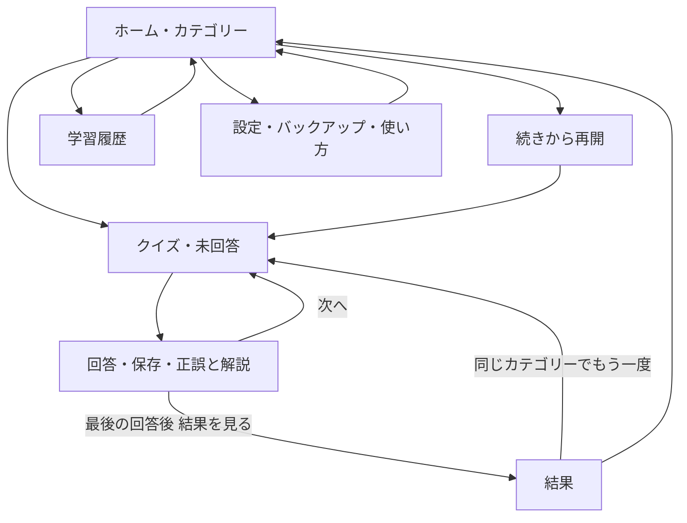

# 製品と画面仕様

## 目的と範囲

生活上の状況や質問から、それに結び付く聖句参照をすぐ思い出せるかを、個人が反復練習する。対象は日本語を読むエホバの証人のユーザー。公式アプリではない個人学習用ツール。知識の採点であり、信仰・人格の評価ではない。

MVP必須: カテゴリー選択、四択、即時解説、進捗、結果、端末内履歴、達成率、セッション再開、バックアップ入出力、インストール案内、オフライン学習、更新通知、GitHub Pages配信。

対象外: ログイン、クラウド同期、サーバー、AI出題、自動スクレイピング、自由記述採点、複数正解、時間制限、通知、課金、ランキング、管理画面、記事の内蔵ブラウザ。問題追加はGit更新と再公開。

## 推奨初期値（未確定事項をこの仕様で決めた値）

| 項目 | 初期値 |
|---|---|
| 言語・表示 | 日本語、ライトテーマ、OSに依存しない、製品名は Verse Practice |
| 問題セット | seed.jsonの6カテゴリー×2問=12問 |
| 問数 | min(10,選択範囲の有効問題数)。同一セッション内重複なし |
| 出題 | 未回答→直近誤答→その他の順で優先、同順位はシャッフル |
| 選択肢 | 聖句参照のみ。各問4択、順序はセッション開始時にシャッフル固定 |
| 習得 | 現行改版の直近2回答がともに正解で「習得済み」 |
| データ | IndexedDB、アカウントなし、バックアップはJSON |
| 公開 | 公開GitHubリポジトリ verse-practice、プロジェクトPages |
| 実装 | React + TypeScript + Vite + Material UI、詳細は04 |

## 画面と遷移

ハッシュルーティング: `#/`、`#/quiz`、`#/result/<sessionId>`、`#/history`、`#/settings`。直接アクセス・リロードで404を出さない。クイズ位置をURLに依存させずDBから復元する。不正IDや履歴未存在は説明してホームへ。

### ホーム

ヘッダーに製品名。短い説明「状況と聖句を結び付けて練習しましょう」。総合達成率と「習得済みx / 全y問」、カテゴリーカード（名称、問題数、達成率）、全カテゴリーの「すべて」を表示。選ぶと開始領域に「今回はN問」と開始ボタン。初期選択は「すべて」。0問ならボタン無効と「準備中」。1〜9問なら実数と「このカテゴリーは全N問です」。

進行中があれば「続きから（カテゴリー・回答済みa/N）」と「終了して新しく始める」を表示。一度に進行中は1件。新規開始時は破棄確認し、既回答履歴は保持して旧セッションをabandonedにする。確認取消なら変更なし。

### クイズ

上部にカテゴリー、`1 / 10問目`、回答済み`0 / 10`、ゲージ。ゲージは保存済み回答数/N×100で、問番号と区別。状況→出典記事タイトル→特定の論点を問う設問→縦に4つの大きな選択ボタン。原典リンクは回答後に出す（参照確認を妨げる制限は設けないが、回答前のヒントにはしない）。

選択をタップした時点で回答確定。二重タップを無効にしDB保存後に正誤表示。正解は「正解です」、誤答は「今回は別の聖句です」。正しい参照と自分の回答、短い理由、出典記事タイトル・見出し、公式記事リンクを示す。他の聖句が一般的に役立たないとは言わない。色だけでなく文字とアイコンで区別する。選択肢はすべて無効化し選び直し不可。

自動遷移しない。「次へ」（最後は「結果を見る」）だけで進む。正誤表示時は見出しにフォーカスしaria-liveで通知。回答前は次へなし。解説はスクロール可能。「中断してホームへ」は状態保持。ブラウザの戻るでも中断扱い。既回答を戻って再採点するUIは作らない。

### 結果

N問中x問正解、正答率（整数%・四捨五入）、達成率の現在値、各問の自分の回答/正答/解説/出典。「同じカテゴリーでもう一度」「ホームへ」。再挑戦は新規セッションであり問題を再抽選。同じ問題順を再演する機能ではない。最後の回答保存時点でcompletedとし、結果画面を開かず終了しても結果を失わない。

### 学習履歴

総合およびカテゴリー別の習得済み数/現行問題数・達成率、現行問題の回答済み率と累計正答率をラベル付き表示。完了・中断終了セッションを新しい順に20件ずつ「さらに表示」。完了結果へのリンク。進行中は再開導線。中断終了は回答済みa/Nとそのうち正解数を表示し、完了セッションと同じ満点比の成績を付けない。旧改版の回答は「旧版」と表示可能だが現行達成率から除外。

### 設定・使い方

JSONを書き出す/読み込む、端末内データ全削除（確認必須）、インストール案内、オフライン準備状態、更新通知、アプリ版と問題セット版、保存状態、プライバシー説明、非公式表示。アプリ説明:「個人学習用の非公式アプリです。公式の説明はリンク先をご確認ください」。端末データは閲覧データ消去・容量制限・プライベートモード・機種変更で失われ得るため、バックアップの用途を簡潔に案内。

## モバイル・アクセシビリティ

幅320pxから横スクロールなし、本文16px以上、行間1.6、操作対象44×44 CSS px以上、主要選択肢は全幅。中央カラム最大720px、タブレット/PCでも同じ順序。上部・下部safe-areaを確保し固定要素で解説や操作を覆わない。基本は通常フローで、ボタン固定は不要。`viewport-fit=cover`、ズーム禁止にしない。200%拡大、キーボード、スクリーンリーダー、横向き、長い参照ラベルで検証。通常文字コントラスト4.5:1以上、visible focus、reduce motion対応。

## 障害時の体験

データ検証失敗は開始を止め、再読み込み/設定への導線。DB初期化失敗は「履歴を保存できません」とし、ユーザーが選ぶ「保存せず試す」でのみメモリモードへ（再読み込みで消える旨を常時表示、バックアップ復元/履歴なし）。通常モードの回答保存失敗では解説を確定表示せず「保存を再試行」、同じ操作IDで冪等再試行。すでにコミット済みならDBの回答を採用。黙ってメモリモードへ切り替えない。外部記事はオンラインが必要とリンク横に説明し、新規タブで開く。
